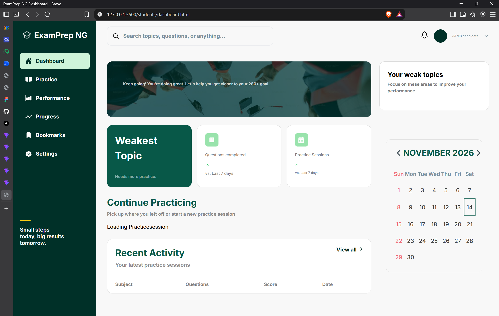
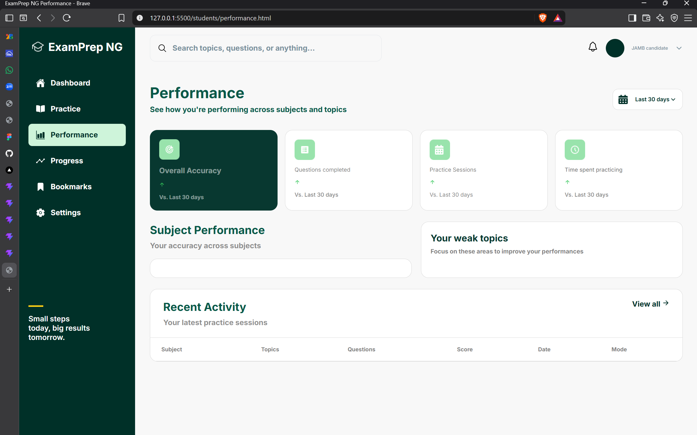
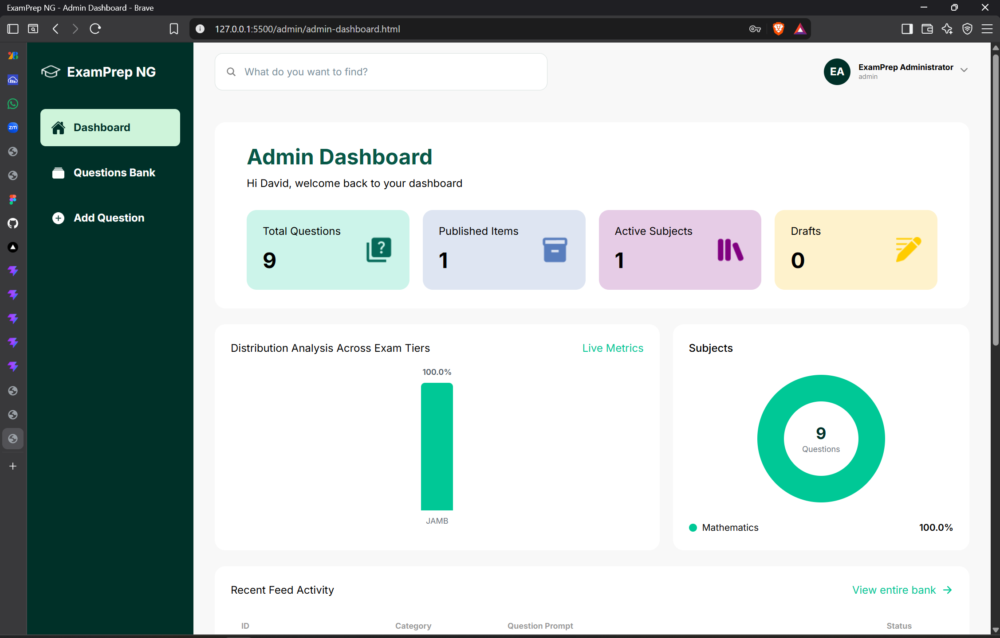

##ExamPrep NG

ExamPrep NG is an online examination preparation platform designed to help students practise examination questions, monitor their academic progress, and improve their performance.

##My Contribution

I contributed as a member of the frontend development team, working on the user interface and preparing the application for API integration.

##Technologies

- React
- JavaScript
- HTML
- CSS
- Tailwind CSS

Key Features

- Student dashboard
- Examination practice interface
- Academic performance tracking
- Subject-based learning experience
- Teachers dashboard
- Admin dashboard

## Screenshots

## Student Dashboard

## Performance Dashboard

## Admin Dashboard

Project Status

The frontend is a work in progress. Some planned features and backend integrations are not yet complete.

Project Type

Collaborative team project — Frontend development.